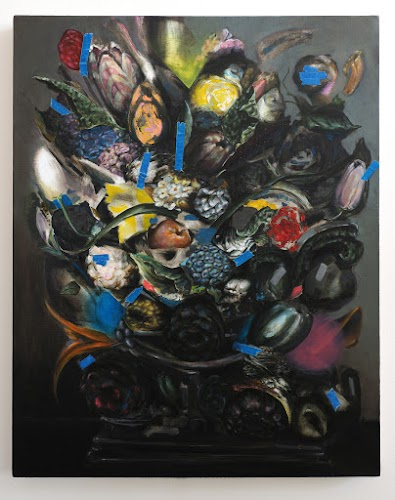

Hi I'm [Ním](http://nimdaghlian.com).

I made this memex.

I'm married to [[Martha]]. We live in [[neighborhood| the Buckman neighborhood of Portland.]]

Our cats are [Frankenstein Minidisc and Elvira Blu-ray](https://www.instagram.com/frankensteinandelvira/). They co-edit the [Buckman Shouter](https://thebuckmanshouter.neocities.org/).

Here are some of my paintings

I wrote the [Theory of Conceptual Labor](https://www.conceptuallabor.com/){:target="_blank"}

[[Nik]] and I made hashtags for the regular websites called [Octothorpes](https://octothorp.es){:target="_blank"} You can see them at work on this site!

I make music as Municipal Xylophone.

<iframe style="width: 300px; height: 300px;" src="https://bandcamp.com/EmbeddedPlayer/album=1261774041/size=large/bgcol=ffffff/linkcol=0687f5/minimal=true/transparent=true/" seamless><a href="https://municipalxylophone.bandcamp.com/album/the-municipal-xylophone">The Municipal Xylophone by Municipal Xylophone</a></iframe>

I make websites as the [Idea Store](https://ideastore.dev/){:target="_blank"}.

I don't use social media much but you can find me on [Mastodon](https://xoxo.zone/@nim){:target="_blank"} and [Bluesky](https://bsky.app/profile/niiiiim.bsky.social){:target="_blank"} and [Sito](https://id.sito.org/ndg/). 

I _have_ been on Tumblr a lot lately. [Shitposts](https://flarmbt.tumblr.com/) and [paintings](https://nimdaghlian.tumblr.com/).

My newsletter is called Big Table and I invite you to it! 2026 update: I haven't posted in a while, but that's going to change soon. 


